# Airbnb Price Prediction Across 10 European Cities

**Project report:** data cleaning, exploratory analysis, machine-learning modelling and deployment as a web app (Altitude).

---

## 1. Executive summary

- **Goal:** predict an Airbnb listing's price from its location (city, coordinates, distance to the centre and metro, nearby attractions and restaurants), its characteristics (room type, capacity, bedrooms), host quality, guest reviews and city-level economic indicators.
- **Data:** 51,707 listings from Amsterdam, Athens, Barcelona, Berlin, Budapest, Lisbon, London, Paris, Rome and Vienna. After cleaning, **51,611 rows** with 29 columns remain.
- **Best model:** a weighted ensemble of **CatBoost (42%) + XGBoost (41%) + LightGBM (17%)** trained on log price.
- **Accuracy on unseen listings:** **R² = 0.857** on log price, **median error 17.1%**, and **74.4% of predictions within ±30%** of the real price. MAE is €87 on a median price of €261.
- **Main price drivers:** how central the location is (the proximity, attraction and restaurant indices plus distance to the centre and metro), then city, room type and capacity. Host status and review scores matter much less.
- **Deliverable:** a Flask web app with a market dashboard, an interactive map explorer (points and heatmaps), a click-on-the-map price predictor with SHAP explanations and comparable listings, a model-performance page, and this report.

> **Note on the target:** `price_total` comes from the public European Airbnb dataset (Gyódi & Nawaro, 2021), where it is the total price in EUR for a **2-night stay for 2 people**. The app therefore also shows an approximate per-night price (total ÷ 2).

---

## 2. Dataset

| Group | Columns |
|---|---|
| Target | `price_total` |
| Listing | `room_type`, `is_shared_room`, `is_private_room`, `max_guests`, `num_bedrooms` |
| Host and reviews | `is_superhost`, `is_multi_listing`, `is_business_listing`, `cleanliness_score`, `guest_satisfaction_score` |
| Location | `latitude`, `longitude`, `distance_city_center`, `distance_metro`, `attraction_index_norm`, `restaurant_index_norm`, `proximity_index` |
| Administrative | `city`, `district`, `state`, `country_name` |
| City economics | `Crime_Index`, `Safety_Index`, `Monthly_Average_Net_salary`, `Taxi_price_per_Km`, `Monthly_Basic_Utilities` |
| Time | `day_type` (weekday / weekend) |

---

## 3. Data cleaning

The file was already mostly clean (no missing values), but validation still turned up some problems:

| Step | Rows removed | Detail |
|---|---|---|
| Drop exported index column | 0 | `Unnamed: 0` was a pandas index |
| Missing-value check | 0 | 0 missing cells |
| Remove exact duplicates | **63** | identical rows |
| Fix country label | 0 | **4,580** Rome rows were geocoded as *Holy See (Vatican City State)*; relabelled *Italy* |
| Room-type flag consistency | 0 | `room_type` matches `is_shared_room` / `is_private_room` |
| Domain range checks | 0 | scores in range, distances ≥ 0, price > 0 |
| Extreme price outliers | **33** | per-city 3×IQR fence on log price; removes entry errors such as a €43,955 listing |

**A finding that matters for evaluation:** **18,774 listings appear twice**, once as a weekday row and once as a weekend row, with almost the same price. A random train/test split would put one copy in training and the other in testing, so the model would be scored partly on listings it had already seen. We give every row a `listing_id` and **split by listing** (see section 5).

`proximity_index` was checked for target leakage. It is a deterministic function of the four location columns (a gradient-boosting model rebuilds it with R² = 0.9994, and adding price on top changes nothing), so it is a valid feature.

---

## 4. Exploratory data analysis

### 4.1 Price distribution
Prices are heavily right-skewed: the median is €261 and the mean is €365. The log of price is close to normal, so all models predict `log1p(price)`.

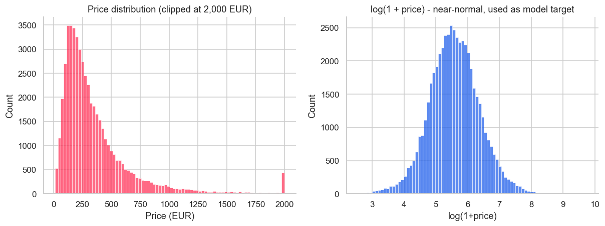

### 4.2 Cities
Amsterdam (€503) and Paris (€450) are the most expensive markets, about 2.5× Athens (€181) and Rome (€194). London has the most listings (9,989).

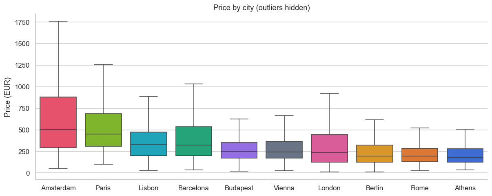

### 4.3 Room type
An entire home or apartment costs roughly 1.5–2.5× a private room in the same city. Shared rooms are rare (0.7%) and the cheapest.

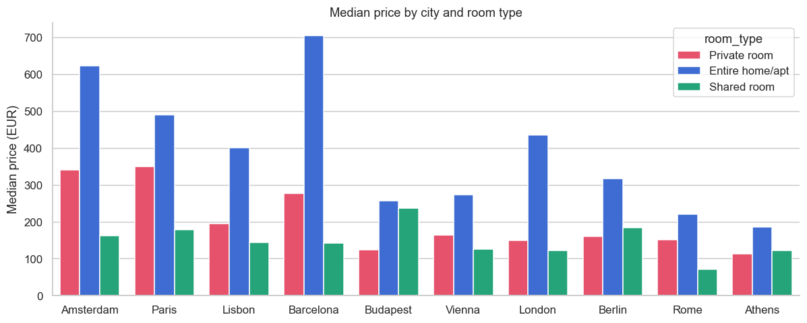

### 4.4 Weekday vs weekend
Across all cities, weekend stays carry a median premium of **+4.6%**. The size of the premium varies by city.

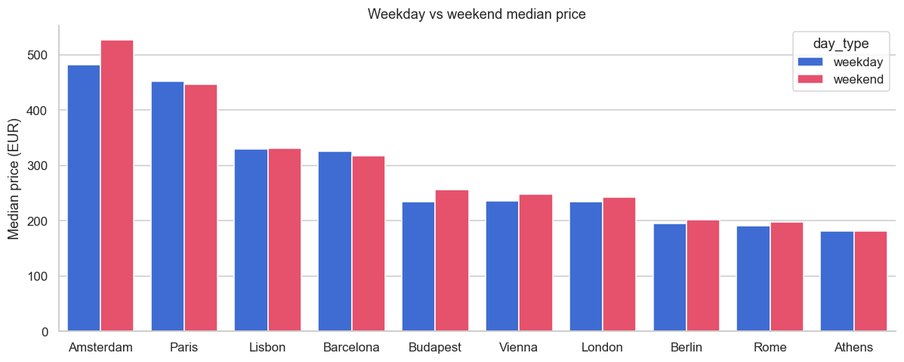

### 4.5 Location effects
Price falls steadily with distance from the centre and rises with the attraction and restaurant indices. Location is the strongest single signal in the data.

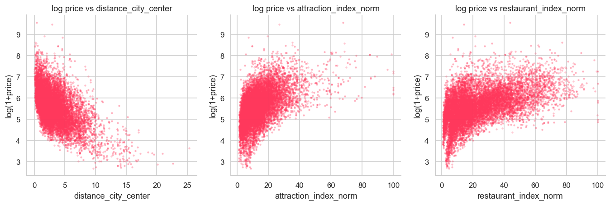

### 4.6 Capacity
Each extra guest or bedroom raises the price in a near-linear, monotonic way.

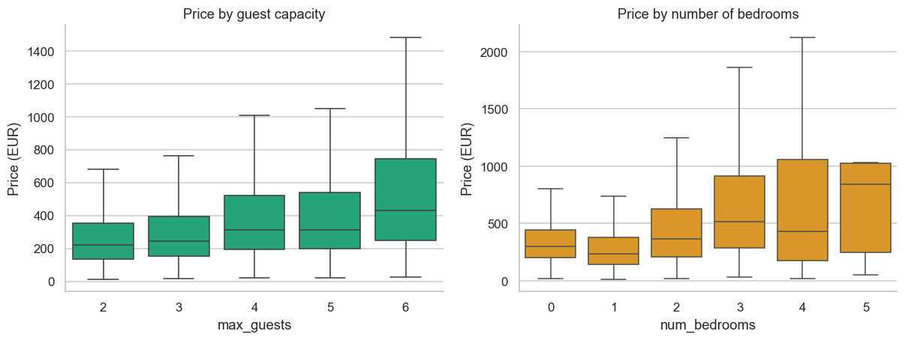

### 4.7 Correlations
Restaurant and attraction indices are strongly correlated with each other and with `proximity_index`. The city-level indices (crime, salary, utilities) are constant within a city, so they act as city descriptors.

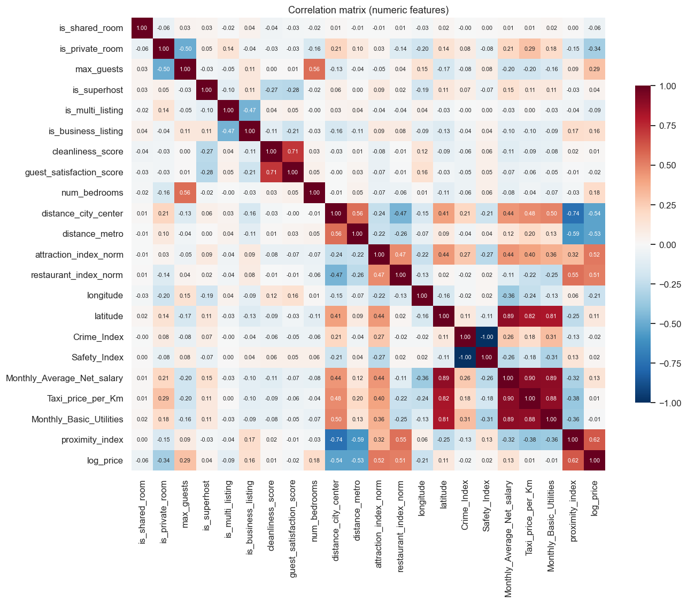

### 4.8 Host quality
Superhost status and high satisfaction scores have only a small effect on price. Guests seem to pay for location and space rather than for reputation.

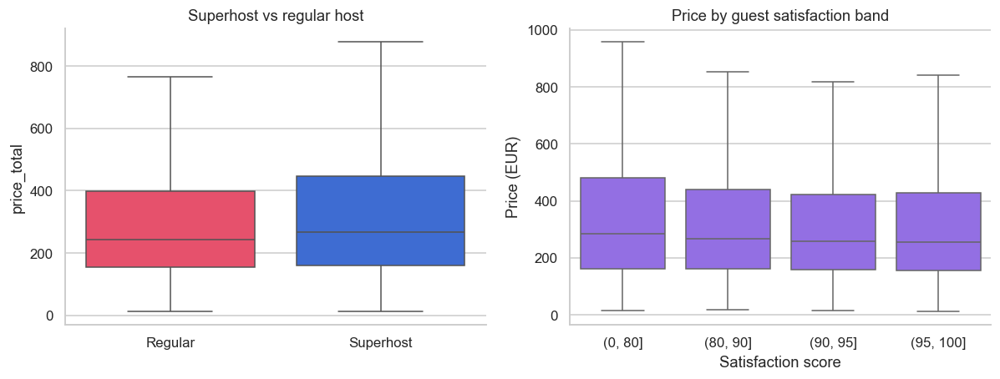

### 4.9 Affluence
Cities with higher average salaries have higher prices, but tourist demand matters too: Lisbon and Barcelona are priced above what their salary levels alone would suggest.

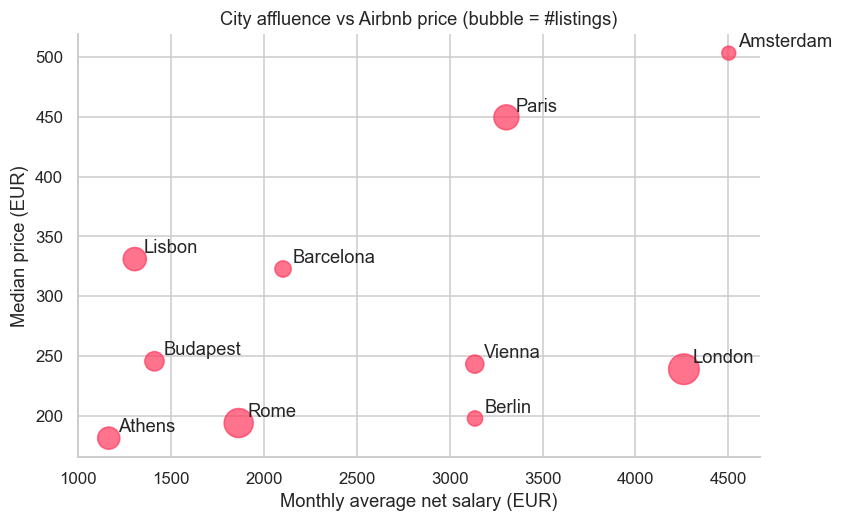

---

## 5. Methodology

### 5.1 Feature engineering (25 features)
In addition to the original listing, location and city features:

| Feature | Rationale |
|---|---|
| `is_weekend` | binary encoding of `day_type` |
| `guests_per_bedroom` | how crowded the unit is |
| `log_dist_center`, `log_dist_metro` | the price decline with distance is steep near the centre and flattens further out |
| `attr_x_rest` | interaction term: a high score requires both attractions and restaurants nearby |
| `quality_score` | 0.4 × cleanliness + 0.6 × satisfaction, on a 0–100 scale |

`district`, `state` and `country_name` were dropped because each is redundant with `city` plus the coordinates. `is_shared_room` and `is_private_room` were dropped because they duplicate `room_type`.

### 5.2 Validation strategy
- **Hold-out test set:** 20% of listings (10,366 rows), using `GroupShuffleSplit` by `listing_id`. No listing appears in both training and test data.
- **Early stopping and ensemble weights:** set on a further grouped 15% validation fold carved out of the training data. The test set is never used for tuning.
- **Production model:** refit on 100% of the data with the tuned number of boosting rounds.

### 5.3 Models
| Model | Configuration |
|---|---|
| City median | baseline |
| Ridge regression | one-hot encoding, standardised features |
| Random Forest | 300 trees, `max_features=0.5` |
| LightGBM | 63 leaves, learning rate 0.02, row and column subsampling, early stopping |
| XGBoost | depth 8, learning rate 0.02, hist method, native categorical support |
| CatBoost | depth 8, learning rate 0.04, native categorical support |
| **Weighted ensemble** | non-negative weights minimising validation MSE |

---

## 6. Results

### 6.1 Leaderboard (hold-out test set, unseen listings)

| Model | R² (log) | R² (€) | MAE € | RMSE € | MAPE | Median APE | ±20% | ±30% |
|---|---|---|---|---|---|---|---|---|
| City median (baseline) | 0.157 | 0.040 | 191.4 | 402.2 | 66.7% | 42.2% | 25.3% | 37.3% |
| Ridge regression | 0.811 | 0.615 | 99.6 | 254.7 | 25.6% | 20.7% | 48.5% | 67.0% |
| Random Forest | 0.847 | 0.635 | 90.1 | 248.1 | 22.3% | 17.2% | 56.0% | 73.1% |
| LightGBM | 0.854 | 0.651 | 88.1 | 242.3 | 22.0% | 17.5% | 55.9% | 74.1% |
| XGBoost | 0.855 | 0.650 | 87.6 | 242.7 | 21.8% | 17.1% | 56.6% | 74.2% |
| CatBoost | 0.856 | 0.653 | 87.3 | 241.9 | 21.8% | 17.3% | 56.4% | 74.2% |
| **Weighted ensemble** | **0.857** | **0.653** | **87.1** | **241.7** | **21.7%** | **17.1%** | **56.5%** | **74.4%** |

**How to read these numbers:**
- **R² on log price (0.857)** is the standard metric for price models. The model explains about 86% of the variation in log price.
- **R² in euros (0.65)** is lower because a few very expensive listings (€2,000–€9,000) dominate squared error in euro terms. Typical-case accuracy is better described by the **median absolute error of 17%**.
- **Random-split comparison:** a naive random row split gives R² = 0.876. That figure is inflated by the duplicated weekday/weekend rows, so **we report the stricter 0.857**.
- Around 14% of the variation cannot be explained by the available columns. It depends on things the dataset does not contain, such as photos, the interior, the size in m², the view, amenities and dynamic pricing.

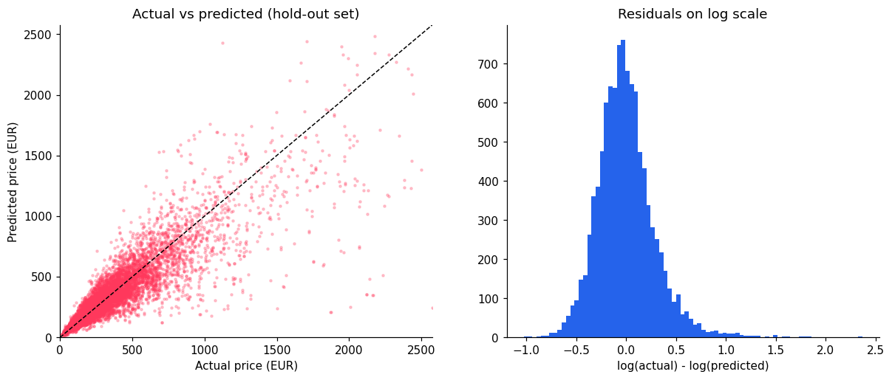

### 6.2 Accuracy by city
Median absolute error ranges from **14.8% (Lisbon)** to **19.3% (Budapest)**. R² on log price is highest in London (0.884) and Amsterdam (0.864). Paris has the lowest R² (0.721) because prices within Paris vary unusually widely even at similar locations.

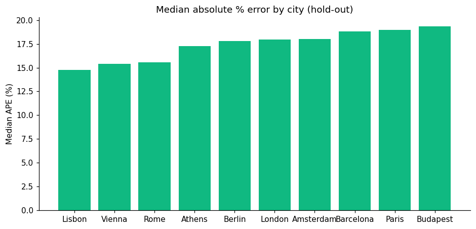

### 6.3 Explainability
The two most important features are `proximity_index` (23% of total gain) and `attr_x_rest` (22%). Next come attraction index, city, room type, distance to metro, longitude, max guests and bedrooms. The SHAP plot shows the direction of each effect: central, well-connected locations, entire homes and more capacity all push the price up.

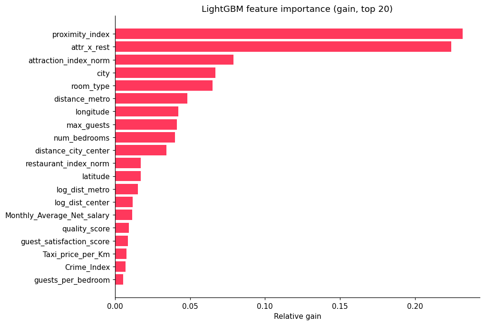
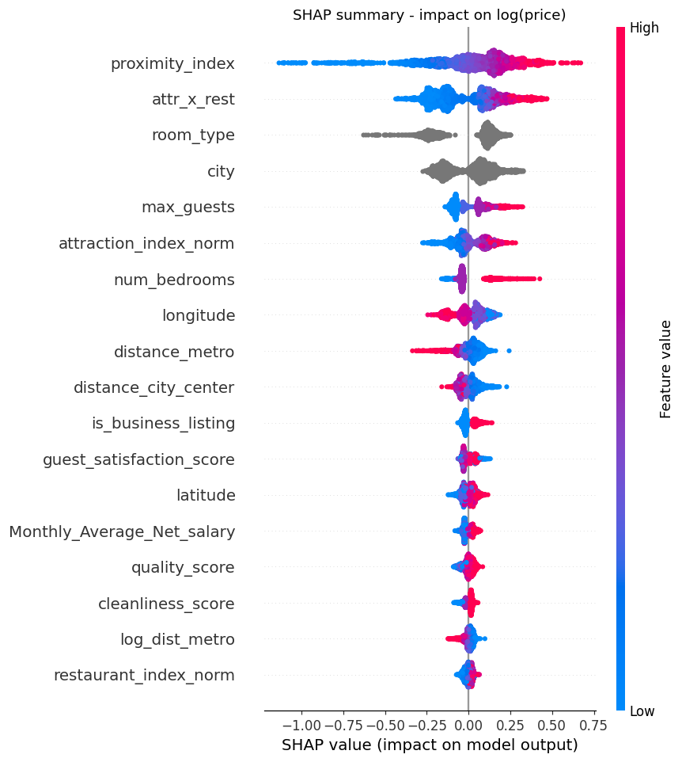

---

## 7. The web application (Altitude)

| Page | What it does |
|---|---|
| **Dashboard** | KPI cards, a map of Europe with a price bubble per city, charts of price by city, room type, distance to centre and capacity, and a city scorecard |
| **Map Explorer** | every listing in a city on an interactive Leaflet map, coloured by price quintile. Switch between point, price-heatmap and density layers; filter by room type, weekday/weekend, maximum price, guests and superhost |
| **Price Predictor** | pick a city, click or drag a pin, describe the listing and get an instant estimate. Shows the 2-night price, per-night price, an 80% prediction interval, comparison with the city and neighbourhood medians, a percentile rank, SHAP price drivers, the auto-derived location profile, the individual model predictions and nearby comparable listings shown on the map |
| **Route Planner** | select the listings to visit on a city map. Shortest paths by Dijkstra and Bellman-Ford, and the best visiting order by the Travelling Salesman algorithms (section 7.1) |
| **Model Performance** | leaderboard, feature importance, accuracy per city, actual-vs-predicted and SHAP plots |
| **Project Report** | this document, rendered inside the app |

**How a prediction works:** a host knows the address of their listing, not its "attraction index". When a pin is dropped, the app finds the 25 nearest real listings in that city and takes a distance-weighted average of their metro distance, attraction index, restaurant index and proximity index. Distance to the centre is computed exactly, using a city centre that the app estimates from the data. The city-level economic indicators are filled in automatically. Advanced users can override any location value.

**Prediction interval:** the 10th–90th percentile of the ensemble's residuals on the test set, computed separately for each city.

**REST API:** `POST /api/predict` (JSON in, prediction out), `POST /api/route`, `GET /api/listings/<city>`, `GET /api/health`.

### 7.1 Route Planner (Design and Analysis of Algorithms)

The user clicks up to 20 listings on the map and marks one as the start. `src/algorithms.py` implements every algorithm from scratch in plain Python:

| Algorithm | Problem solved | Time complexity | Notes |
|---|---|---|---|
| k-nearest-neighbour graph | builds the network | O(V² log V) | each stop is linked to its k nearest stops (haversine km); components are joined by DFS until connected |
| Dijkstra | shortest path from the start to every stop | O((V + E) log V) | binary min-heap with lazy deletion; needs non-negative weights |
| Bellman-Ford | the same, by edge relaxation | O(V · E) | at most V−1 passes with early exit, then one extra pass for negative-cycle detection |
| All-pairs Dijkstra | distance matrix for the TSP | O(V (V + E) log V) | the TSP runs on graph distances, so each leg follows a real shortest path |
| Held-Karp | exact Travelling Salesman tour | O(n² · 2ⁿ) time, O(n · 2ⁿ) memory | bitmask dynamic programming; used for up to 12 stops |
| Nearest neighbour + 2-opt | heuristic Travelling Salesman tour | O(n²) per 2-opt pass | greedy tour, then segment reversals while they shorten it |

The page shows each algorithm's result, path or tour, operation counts (edge relaxations, heap pushes, Bellman-Ford passes, DP transitions, 2-opt swaps) and run time, together with the gap between the heuristic and the exact optimum. It also checks that Dijkstra and Bellman-Ford give identical distances to every stop, and shows the all-pairs distance matrix.

**Correctness tests** (`python -m unittest discover tests`, 11 tests): Dijkstra and Bellman-Ford against Floyd-Warshall on 30 random graphs, a hand-worked example, negative edges and negative-cycle detection for Bellman-Ford, Held-Karp against O(n!) brute force for 3–8 stops, the heuristic never beating the exact optimum, and tours visiting every stop exactly once.

---

## 8. Limitations and next steps
- The coordinates in the source data are rounded to 0.01° (about 1 km), so fine-grained location relies on the distance and index columns.
- There are no listing photos, size, amenities, booking dates or seasonality. Adding them is the most promising way to improve accuracy.
- The data is a snapshot from a single period. Prices should be re-validated before the model is used for live pricing.
- Possible extensions: quantile models trained directly for prediction intervals, hyper-parameter search with Optuna, text features from listing titles, and Docker deployment.

---

## 9. How to run

```bash
pip install -r requirements-ml.txt
python run_pipeline.py      # cleaning -> EDA -> training (about 7 min)
python app.py               # open http://127.0.0.1:5000
```

**Live deployment (Vercel):** the serverless version installs only Flask, numpy, pandas and markdown. It serves the LightGBM model through a numpy-only export of its trees (`models/lgbm_lite.npz`), which gives identical predictions to LightGBM (R² 0.854 vs 0.857 for the ensemble) and keeps the bundle well under Vercel's size limit.

**Project structure**
```
Cleaned_data.csv            raw input
src/config.py               paths and constants
src/clean.py                step 1: cleaning and validation
src/eda.py                  step 2: EDA figures and dashboard data
src/features.py             feature engineering
src/train.py                step 3: training, evaluation, export
src/predictor.py            inference service (location features, SHAP)
src/algorithms.py           Dijkstra, Bellman-Ford, Held-Karp, 2-opt (Route Planner)
tests/                      unit tests for the algorithms
app.py                      Flask web app and REST API
templates/, static/         UI (HTML, CSS, JS, figures)
models/                     model.joblib, metrics.json, eda.json
reports/                    REPORT.md, REPORT.docx, cleaning_log.json
```
